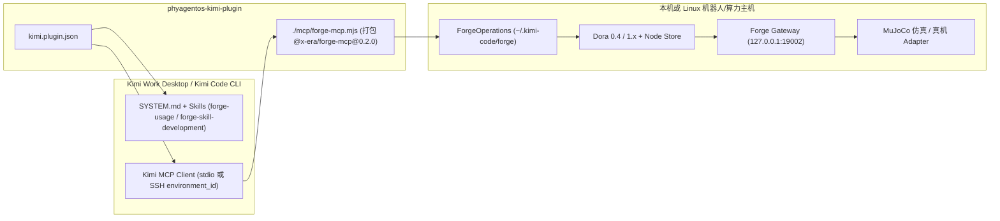

# `phyagentos-kimi-plugin` 快速开发与市场上架可行性调研

> [!IMPORTANT]
> **核心结论（一句话版）**：**完全支持快速开发，现有底座复用度达 85%–90%。**
> 上游仓库 [PhyAgentOS-DSH-Plugin](https://github.com/PhyAgentOS/PhyAgentOS-DSH-Plugin)（上游 `main` 与公共 npm 已发至 `0.2.0`）已经把核心能力解耦为宿主无关的 `@x-era/forge-core@0.2.0` 与标准 stdio MCP 服务 `@x-era/forge-mcp@0.2.0`（已暴露 39 个工具）。**零改上游代码即可在 0.5–1 天内封装出面向 Kimi Work 桌面端与 Kimi Code 的可用 MVP 插件**；但若要上架 Kimi **公开市场**并顺滑覆盖 Mac/Windows 桌面用户，有 **宿主运行边界** 与 **5 个源码级细节** 需要提前对齐。

---

## 一、客观事实盘点（Objective Facts）

### 1. 我们现有的可复用资产（`PhyAgentOS-DSH-Plugin` v0.2.0）

| 现有模块 | 当前状态（`0.2.0`） | 与 DSH 耦合度 | 在 Kimi 插件中的直接复用方式 |
| :--- | :--- | :--- | :--- |
| `@x-era/forge-core` | 已发布公共 npm `0.2.0`（Node `>=22`，纯 ESM，仅依赖纯 JS 包 `yaml` 与 `tar`） | **零耦合**（无 `@deepseek-ai/cordis` 依赖） | 100% 复用：Registry 检索/下载、SHA256 校验、Dora 0.4/1.x 启停、Gateway Tool API 调用、环境体检与初始化、模型仓库与源码追溯 |
| `@x-era/forge-mcp` | 已发布公共 npm `0.2.0`（[forge-mcp.mjs](https://github.com/PhyAgentOS/PhyAgentOS-DSH-Plugin/blob/main/packages/mcp/bin/forge-mcp.mjs)） | **零耦合**（按行 JSON-RPC stdio MCP，`2024-11-05`） | 直接作为 `kimi.plugin.json` 的 `mcpServers.forge` 暴露 **39 个 `forge_*` 工具** |
| 内置指南与安全规则 | 位于 [usage.ts](https://github.com/PhyAgentOS/PhyAgentOS-DSH-Plugin/blob/main/packages/skill/src/usage.ts) 与 [development.ts](https://github.com/PhyAgentOS/PhyAgentOS-DSH-Plugin/blob/main/packages/skill/src/development.ts) | 仅文本常量被 Cordis 包装 | 1:1 拆出为 Kimi 插件的 `./skills/forge-usage/SKILL.md`、`./skills/forge-skill-development/SKILL.md` 与 `./SYSTEM.md` |
| Portable 导出器 | `forge_skill_export`（见 [portability.md](https://github.com/PhyAgentOS/PhyAgentOS-DSH-Plugin/blob/main/docs/portability.md)） | **零耦合** | 已自动合成带 `name` / `description` / `whenToUse` frontmatter 的 `SKILL.md`，可直接导出至 `~/.kimi-code/skills/` |
| PAOS 公共 Registry | `https://paos-resource-platform.dev.x-era.com/v1/skills` | 公网匿名可读（实测 HTTP 200，~16ms） | 开箱即用，无需强制配置私有 Token 即可完成市场审核期的检索与体检 |

> [!NOTE]
> 上游 `PhyAgentOS/PhyAgentOS-DSH-Plugin` 的 `main`（`6c26d63`）及公共 npm 已更新到 `0.2.0`，相比早期 `0.1.1`（21 个工具）新增了 `forge_environment_check`、`forge_environment_setup`、`forge_model_*`、`forge_repo_*`、`forge_node_source` 等关键能力，MCP 工具数已扩充至 **39 个**。

---

### 2. Kimi 插件机制与公开市场规则（基于官方文档核实）

1. **统一插件规范（`kimi.plugin.json`）**
   - Kimi Plugin 遵循 [Kimi Code 插件定义](https://www.kimi.com/code/docs/kimi-code-cli/customization/plugins.html#plugin-manifest)，是**声明式目录/压缩包**（不执行 Cordis 这类宿主内部 JS 插件代码），支持 6 类组件：
     - `mcpServers`：支持本地子进程 `stdio`（`command` + `args` + `env` + `environment_id`）及远程 `HTTP` / `SSE`。
     - `skills`：插件根目录内的 `./skills/<name>/SKILL.md`（目录型必填 `name` 与 `description`；Kimi 自定义技能命名限制为小写字母、`-`、`_`，长度 `<= 25` 字符——`forge-usage` 11 字符、`forge-skill-development` 23 字符均天然合规）。
     - `systemPrompt` / `systemPromptPath`：单文件上限 32 KB（我们的运行与物理安全红线约 1.8 KB，完全充裕）。
     - `sessionStart.skill`、`commands`（斜杠命令 `./commands/*.md`）、`agents`（子智能体）、`hooks`（`PreToolUse` 等生命周期脚本）及 `interface`（含多语言 `./locales/*.json`）。
2. **个人创建与导入路径**
   - **Kimi Work 桌面端**：点击截图中的 `+ Custom plugin`（或在对话中 `/` 唤起内置 `Plugin Builder`），直接发送 GitHub 仓库链接即可自动识别 `kimi.plugin.json`，转换至工作区并登记到「Custom / 个人」页签安装使用。
   - **Kimi Code CLI / Desktop**：直接支持 `/plugins install https://github.com/PhyAgentOS/PhyAgentOS-Kimi-Plugin`（走 `github.com` 与 `codeload.github.com`，拷贝至 `$KIMI_CODE_HOME/plugins/managed/<id>/` 托管运行）。
3. **宿主运行边界（最关键的产品约束）**
   - **Kimi Work 桌面端（macOS / Windows）与 Kimi Code（CLI / Desktop / VS Code）**：底层共用本地 Kimi Code Agent 内核，**完整支持本地 `stdio` MCP、Skills、`SYSTEM.md`、Commands、Hooks 及 SSH 远程环境（`environment_id`）**。
   - **Kimi Web 纯网页端（云端 `Chat`）**：运行在月之暗面云端容器，仅支持云端可达的远程 HTTP MCP + Skills，**无法拉起用户本机 `stdio` 进程，也无法访问本机 `127.0.0.1:19002` Gateway、Dora、MuJoCo 窗口或 USB/CAN 真机硬件**。
   - Kimi 官方市场索引（`marketplace.json` v2）原生支持通过 `clients: ["desktop", "cli"]` 与 `platforms: ["macos", "linux", "windows"]` 限制插件可见范围（与官方桌面插件 `Kimi Computer Use` 机制一致）。
4. **公开市场上架流程**
   - **非自助秒上架**：需先作为个人自定义插件完成创建与基础测试，随后在 Kimi 插件详情页点击右上角 `✉️` → 选择 **「申请发布到官方市场」** 并留联系邮箱，由 **Kimi 官方团队人工评估审核**（内容完整性、稳定性与可测性）。

---

## 二、逻辑推演与源码级差距分析（6 个真实工程注意点）



对比 DSH 插件（`@x-era/dsh-forge-skill`）与 Kimi 插件机制，逐行核对 `0.2.0` 源码后，实际工程差距集中在以下 **6 点**（均无架构死结）：

### 1. DSH 动态能力如何映射到 Kimi 静态托管目录？
- **差异事实**：DSH 插件通过 Cordis API 在运行时挂载了 3 项动态宿主特性：① `ctx.skills.registerProvider` 实时监听 `~/.dsh/forge/skills/` 把新装机器人包变成宿主顶层 Skill；② `DynamicToolRegistry` 动态展开 Gateway 工具；③ `/forge/api` 配置面板路由。而 Kimi 插件在安装时会被拷贝进 `$KIMI_CODE_HOME/plugins/managed/<id>/`，且**安全策略禁止任何解析后跳出插件根目录的软链接**，忽略 `tools`/`inject` 等非标字段。
- **解决路径（零阻塞）**：
  1. 模型直接通过 MCP 的 `forge_skill_list` → `forge_skill_read` / `forge_skill_docs` → `forge_tool_context` → `forge_tool_call` 完成全部发现与调用（与 Claude Code 接入方式一致）。
  2. 如需将某个常用机器人 Skill 变成 Kimi 原生 `/` 技能，直接调用现成的 `forge_skill_export` 导出到 `~/.kimi-code/skills/<name>`——根据 Kimi 文档，用户级 `~/.kimi-code/skills/` 支持文件变更**自动热刷新**，无需重启会话。

### 2. DSH 专属配置工具（`cordis.patch.yml`）与数据目录冲突
- **源码事实**：
  1. `@x-era/forge-mcp@0.2.0` 暴露了 `forge_config_read`、`forge_config_write`、`forge_config_restore`，但底层 `DshProfileStore` 读写的是 `~/.dsh/profiles/<profile>/cordis.patch.yml`；而 `forge-mcp.mjs` 启动时只读环境变量（`DSH_FORGE_*`），**根本不读 `cordis.patch.yml`**，在 Kimi 中调用这 3 个工具会产生误导。
  2. `resolveForgeHome()` 默认落到 `~/.dsh/forge`，而 `development.ts` 明确规定 `state.json` 为单写者，不应让两个宿主同时操作同一个 `home`。
- **解决路径**：
  - **MVP 零改代码方案**：直接在 `kimi.plugin.json` 的 `mcpServers.forge` 中设置 `"disabledTools": ["forge_config_read", "forge_config_write", "forge_config_restore"]`；同时讨论决定默认复用 `~/.dsh/forge`（省去重复下载数 GB 节点与模型，但不同时开 DSH）还是通过 `env` 指向独立目录（或由环境变量覆盖）。
  - **V1 上游增强**：向 `PhyAgentOS-DSH-Plugin` 提一个小 PR，支持宿主无关的 `<home>/config.json` 配置读写。

### 3. `runtime.ts` 首装环境后的缓存小 Bug（建议顺手修上游）
- **源码事实**：在 `packages/core/src/runtime.ts` 第 88–93 行，`SkillRuntimeManager` 在 `constructor` 中一次性执行 `existsSync(<home>/support/bin/dora)` 并缓存到 `this.localDora`。由于 Kimi 的 stdio MCP 进程随会话常驻，**新机器首次会话中先跑 `forge_environment_setup` 装好 `dora`/`dora1`，紧接着在同一会话跑 `forge_runtime_start` 时，仍会读到启动时缓存的 `'dora'` 而报 `ENOENT`**，必须 `/reload` 或新开会话才生效。
- **解决路径**：
  - MVP 阶段在 `forge-usage/SKILL.md` 中写明：“首次执行 `forge_environment_setup` 完成后，请提醒用户执行 `/reload` 或新建会话再启动 runtime”。
  - 上游 `PhyAgentOS-DSH-Plugin` 仅需改 4 行代码（在 `get dora()` / `get dora1()` getter 中动态检查 `existsSync`）即可彻底消除。

### 4. MCP 工具对齐小缺口（2 个本地开发工具）
- **源码事实**：DSH 的 `tools.ts` 有 40 个工具，而 `0.2.0` 的 `forge-mcp.mjs` 有 39 个工具——漏挂了 `forge_skill_package`（打包本地 bundle）与 `forge_skill_install_local`（从本地归档安装），且 `serverInfo.version` 仍硬编码为 `'0.1.0'`。
- **解决路径**：不影响常规检索/安装/仿真/真机控制；若需在 Kimi 内闭环开发打包机器人 Skill，可在插件内附带薄封装或向上游 `packages/mcp` 补齐这 20 行映射。

### 5. 冷启动稳定性与 Node.js 运行时前提（强烈建议单文件预打包）
- **风险推演**：若 `kimi.plugin.json` 直接写 `"command": "npx", "args": ["-y", "@x-era/forge-mcp@0.2.0"]`，在国内网络无镜像缓存时首次 `npx` 下载可能超过 Kimi MCP 默认连接超时（`startupTimeoutMs: 30000` = 30s）；且 `forge_runtime_start`（默认最长等 120s）和 `forge_environment_setup` 容易触发单次工具超时。
- **最佳实践**：
  1. 因为 `@x-era/forge-core` 只依赖纯 JS 的 `yaml` 和 `tar`（无原生 C++ 编译产物），在 `phyagentos-kimi-plugin` 构建脚本中直接用 `esbuild` 把 `@x-era/forge-mcp@0.2.0` 打成插件内的单文件 `./mcp/forge-mcp.mjs`（约几百 KB），配置 `"command": "node", "args": ["./mcp/forge-mcp.mjs"]`——**零网络下载、50ms 内启动、版本绝对锁定**（仅需本机装有 `Node.js >= 22`）。
  2. 在 `mcpServers.forge` 中显式声明 `"startupTimeoutMs": 60000` 与 `"toolTimeoutMs": 180000`。

### 6. 桌面端 OS（Mac / Win）与预编译机器人节点（`linux/x86_64`）的跨平台现实
- **客观事实**：Kimi Work 桌面端目前运行在 **macOS / Windows**（Kimi Code CLI 支持 Linux / macOS / Windows），而当前 PAOS Registry 上发布的多数预编译机器人/MuJoCo 节点制品（如 `robot-control-sim` 的 9 个节点）锁定的参考架构是 **`linux/x86_64`**（`environment.ts` 在非 `linux/x64` 主机上返回 `FORGE_ENV_PLATFORM_UNSUPPORTED` 警告）。
- **应对策略（产品叙事与市场审核极其关键）**：
  1. **macOS / Windows 本机直接可用**：`forge_environment_check`、Registry 检索（`forge_skill_search`）、节点仓库与源码阅读（`forge_repo_*`、`forge_node_source`）、本地 bundle 校验与 profile 编辑、以及纯 Python 源码态的 Forge 2 数据流均可本机直接运行——**足以让 Kimi 官方审核人员在无硬件 Mac 上顺利验通 MCP 工具链**。
  2. **Linux 真机 / MuJoCo 全量运行**：
     - 开发者直接在 Ubuntu (`linux/x86_64`) 用 **Kimi Code CLI / VS Code** 安装本插件，100% 本地闭环；
     - 或者在 Mac/Windows **Kimi Desktop** 中利用 Kimi 原生支持的 **SSH 远程环境**（在 `~/.kimi-code/config.toml` 配好 `[environments.robot-box]`，把 MCP 的 `environment_id` 指向 Linux 算力/机器人主机），即可在桌面端直接操控远端 Linux 上的 Dora 与机械臂/MuJoCo！
  3. **二期高杠杆演进（可选）**：给 `@x-era/forge-mcp` 增加一个轻量的 `--http`（Streamable HTTP MCP）启动模式（约 80 行代码），部署在 Linux 机器人主机上，这样连本机没装 Node 22 的 Kimi Work 用户甚至 Kimi Web 端都能通过 URL 接入。

---

## 三、推荐的 `PhyAgentOS-Kimi-Plugin` 极简架构蓝图

新建独立公开仓库（如 `PhyAgentOS/PhyAgentOS-Kimi-Plugin`，与 `PhyAgentOS-DSH-Plugin` 命名对称，中英文 `README.md` / `README_zh.md` 分开维护）：

```text
PhyAgentOS-Kimi-Plugin/
├── kimi.plugin.json                       # Kimi 原生插件清单
├── SYSTEM.md                              # 注入 USAGE_SYSTEM_SECTION + RUNTIME_RULES_SECTION（物理安全红线）
├── mcp/
│   └── forge-mcp.mjs                      # 由 @x-era/forge-mcp@0.2.0 预打包的单文件 ESM（零 npx 网络依赖）
├── skills/
│   ├── forge-usage/
│   │   └── SKILL.md                       # 源自 usage.ts（补齐 YAML frontmatter）
│   └── forge-skill-development/
│       └── SKILL.md                       # 源自 development.ts（补齐 YAML frontmatter）
├── commands/
│   ├── env.md                             # /phyagentos:env 一键环境体检与依赖诊断
│   ├── skills.md                          # /phyagentos:skills 查看已装与可装机器人 Skill
│   └── doctor.md                          # /phyagentos:doctor $ARGUMENTS 指定 Skill 排障
├── locales/
│   ├── zh-CN.json                         # 中文市场卡片与能力描述
│   └── en-US.json                         # 英文市场卡片与能力描述
├── scripts/
│   └── bundle-mcp.mjs                     # 从锁定版本的 @x-era/forge-mcp 构建 mcp/forge-mcp.mjs 并校验
├── README.md                              # 英文使用与架构说明（顶部互链 README_zh.md）
└── README_zh.md                           # 中文使用、SSH 远程机器人主机配置与市场上架说明
```

### `kimi.plugin.json` 核心草案参考

```json
{
  "name": "phyagentos",
  "version": "0.2.0",
  "description": "Install, inspect, diagnose and run PhyAgentOS Forge robot & simulation skills in Kimi.",
  "license": "MIT",
  "homepage": "https://github.com/PhyAgentOS/PhyAgentOS-Kimi-Plugin",
  "skills": "./skills/",
  "commands": "./commands/",
  "systemPromptPath": "./SYSTEM.md",
  "interface": {
    "defaultLocale": "zh-CN",
    "locales": "./locales/",
    "displayName": "PhyAgentOS Forge",
    "shortDescription": "连接 PhyAgentOS 具身智能与机器人仿真/真机技能生态",
    "developerName": "PhyAgentOS",
    "websiteURL": "https://github.com/PhyAgentOS",
    "mcpOverrides": {
      "forge": {
        "displayName": "Forge Runtime & Registry MCP",
        "description": "管理 Forge 技能检索、安装、环境自检、Dora 运行时与机器人 Gateway 工具调用"
      }
    }
  },
  "mcpServers": {
    "forge": {
      "command": "node",
      "args": ["./mcp/forge-mcp.mjs"],
      "startupTimeoutMs": 60000,
      "toolTimeoutMs": 180000,
      "disabledTools": [
        "forge_config_read",
        "forge_config_write",
        "forge_config_restore"
      ]
    }
  }
}
```

---

## 四、高 ROI 分阶段实施排期

| 阶段 | 周期估算 | 交付目标与工作内容 | 是否依赖上游发版 |
| :--- | :--- | :--- | :--- |
| **Phase 1：MVP 快速打通（个人市场可用）** | **0.5 – 1 天** | 搭建 `PhyAgentOS-Kimi-Plugin` 仓库：预打包 `@x-era/forge-mcp@0.2.0`、迁移 2 个内置 Skill 与 `SYSTEM.md` 安全规则、补齐 3 个快捷斜杠命令与双语 README；在 Kimi Work「Custom plugin」与 Kimi Code CLI 跑通导入、环境体检、Registry 检索与仿真调用。 | **否（零改上游）** |
| **Phase 2：公开市场提审准备** | **0.5 天** | 编写零真机可复现的「官方审核员 3 分钟测试指引」（Mac/Win 可测环境体检+Registry 搜索+节点源码检视；Linux 可测 `robot-control-sim` MuJoCo 闭环），在详情页右上角 `✉️` 提交「申请发布到官方市场」（明确标注适配 `desktop` / `cli` 本地内核，非纯云端 Web）。 | **否** |
| **Phase 3：上游体验打磨（可选并行）** | **0.5 – 1 天** | 向 `PhyAgentOS-DSH-Plugin` 提交个人 fork PR：① 修复 `runtime.ts` 首装 `dora` 路径懒解析；② 为 `packages/mcp` 补齐 `forge_skill_package` / `forge_skill_install_local`；③（按需）增加 `--http` 远程 MCP 模式，打通无 Node 桌面端与跨机直连 Linux 机器人。 | 是（走 `0.2.1` 小版本） |
