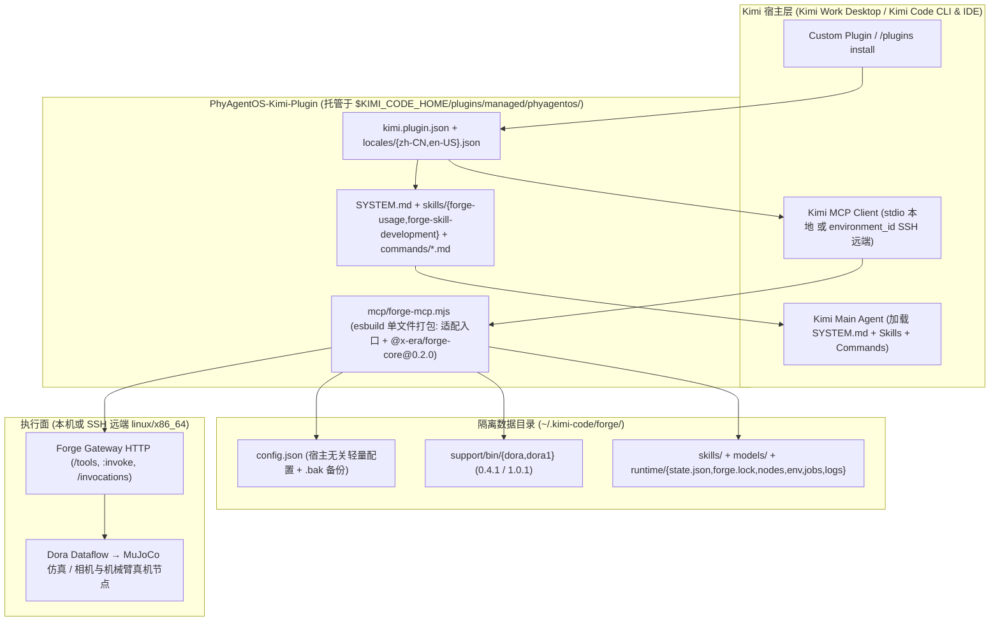

# `PhyAgentOS-Kimi-Plugin` 技术实施方案与设计文档目录

> [!IMPORTANT]
> **三大架构决策已锁定**
> 1. **仓库形态**：新建独立公开仓库 `PhyAgentOS/PhyAgentOS-Kimi-Plugin`（根级 `kimi.plugin.json` 单插件结构，中英文 `README.md` / `README_zh.md` 分开维护并顶部互链）。
> 2. **数据目录**：采用**隔离目录策略**（默认 `~/.kimi-code/forge`，随 `$KIMI_CODE_HOME` 自动迁移），与 DSH 的 `~/.dsh/forge` 物理隔离，彻底消除单写者 `state.json` 与网关生命周期互踩；同时保留大模型权重目录按需只读复用的配置出口。
> 3. **目标宿主**：首期聚焦 **Kimi Work 桌面端（macOS / Windows）+ Kimi Code（CLI / Desktop / VS Code）**，采用本地 `stdio` MCP + Kimi 原生 SSH `environment_id` 连接 `linux/x86_64` 仿真/真机主机，暂不包含纯云端 Kimi Web 远程 Gateway 托管。

---

## 一、总体技术方案（Architecture & Implementation Plan）

### 1. 系统分层与运行拓扑

插件自身保持**极薄声明式外壳 + 单文件 MCP 适配入口**，100% 复用上游已发布的 `@x-era/forge-core@0.2.0`，不复制任何核心业务逻辑：



支持三种开箱即用的运行拓扑：
- **拓扑 A（Linux 原生全闭环）**：Ubuntu `linux/x86_64` 上运行 Kimi Code CLI / VS Code，本机直接完成环境初始化、节点拉取、MuJoCo 仿真与真机控制。
- **拓扑 B（Mac/Win 桌面端 + SSH 远端机器人主机）**：macOS/Windows 运行 Kimi Work 或 Kimi Code Desktop，在 `~/.kimi-code/config.toml` 声明 `[environments.robot-box]`（SSH 指向 `linux/x86_64` 算力/工控机），为插件 MCP 配置 `"environment_id": "robot-box"`，在桌面自然语言对话操控远端仿真与真机。
- **拓扑 C（Mac/Win 纯本机研发与市场提审验收）**：无需连接 Linux 主机，本机直接运行环境体检、PAOS Registry 检索、节点源码追溯（`forge_node_source`）、本地 Skill 校验打包、Profile 编辑及 Python 源码态 Forge 2 数据流。

---

### 2. 核心设计要点（逐项解决调研识别的工程细节）

#### (1) 免编译 GitHub 直装（单文件 ESM 预打包）
- **原因**：Kimi 的 `Plugin Builder` 与 `/plugins install <github-url>` 通过 `codeload.github.com` 拉取仓库快照并拷贝到 `$KIMI_CODE_HOME/plugins/managed/phyagentos/`，**安装过程不会执行 `npm install`**；若运行时走 `npx -y @x-era/forge-mcp`，国内冷启动下载易触发 Kimi 默认 30s 连接超时。
- **方案**：`@x-era/forge-core@0.2.0` 仅依赖纯 JS 的 `yaml` 与 `tar`（无原生 C++ 扩展）。仓库源码维护薄入口 `src/forge-mcp.ts`（或 `.mjs`），通过 `esbuild` 打包为单文件 `mcp/forge-mcp.mjs` 提交入库，并在 CI 中强制执行 `pnpm build:check` 校验产物零漂移。用户从 GitHub 安装后由 `node ./mcp/forge-mcp.mjs` 50ms 内零网络启动（要求 Node.js `>=22`）。

#### (2) 隔离目录解析链与大模型权重共享出口
- **路径解析优先级**（在 `src/forge-mcp.mjs` 入口统一收敛）：
  1. `KIMI_FORGE_HOME`（Kimi 插件专用显式环境变量）
  2. `DSH_FORGE_HOME`（兼容 Forge 通用环境变量，便于远端脚本统一注入）
  3. `KIMI_CODE_HOME ? join(KIMI_CODE_HOME, 'forge') : '~/.kimi-code/forge'`（默认隔离目录，经 `expandHome` 展开为绝对路径）
- **隔离目录结构（`~/.kimi-code/forge/`）**：
  - 独占 `runtime/state.json`、`runtime/forge.lock`、`skills/`、`support/bin/{dora,dora1}`，**绝不读写 `~/.dsh/` 下任何文件**。
  - **模型权重按需复用**：默认 `<home>/models`；若本机已有数十 GB 校验过的模型库（如 `~/.dsh/forge/models` 或 `/data/models`），可通过 `<home>/config.json` 的 `models.root` 或环境变量 `DSH_FORGE_MODELS` 只读指向该目录，避免重复占用磁盘。

#### (3) 轻量 `<home>/config.json` 与首装 `dora` 无缝热刷新
- **去 DSH 耦合**：不再调用读写 `~/.dsh/profiles/<p>/cordis.patch.yml` 的 `DshProfileStore`；改为在 MCP 适配层用约 60 行代码读写 `~/.kimi-code/forge/config.json`（保留字段白名单校验、`0600` 权限原子替换与 `config.json.bak-<timestamp>` 备份恢复），对外仍保持 `forge_config_read` / `forge_config_write` / `forge_config_restore` 三个工具名与契约一致。
- **消除首装重启断点**：在 `forge_environment_setup` 或 `forge_config_write` 执行成功后，MCP 进程内部自动重建 `ForgeOperations` 实例并调用 `await operations.runtime.load()`，从而立即识别刚安装到 `~/.kimi-code/forge/support/bin/{dora,dora1}` 的可执行文件，**同一会话内即可直接 `forge_runtime_start`，无需用户手动 `/reload`**。

#### (4) 完整 41 个 MCP 工具面与超时配置
- 在 `@x-era/forge-mcp@0.2.0` 已有 39 个工具基础上，补齐 `@x-era/forge-core@0.2.0` 已具备的 `forge_skill_package` 与 `forge_skill_install_local`，合计暴露 **41 个工具**。
- `kimi.plugin.json` 中显式设置 `"startupTimeoutMs": 60000`、`"toolTimeoutMs": 180000`，确保 `forge_environment_setup` 与 `forge_runtime_start`（最长 120s 网关就绪轮询）不被宿主提前中断。

#### (5) 物理安全红线与内置 Skills / Commands 适配
- **`SYSTEM.md`（~2 KB）**：完整植入 `USAGE_SYSTEM_SECTION` + `RUNTIME_RULES_SECTION`（失败即停并报告 `FORGE_*` 诊断码；禁止自动修复/杀进程/改端口；启停 runtime 必须有用户明确指令；Action 返回 `unknown` 必须先读 `forge_invocation_read` 严禁盲目重发；Forge 2 走 `run` 模式）。
- **内置 Skills（均符合 Kimi `<= 25` 字符小写命名规范）**：
  - `skills/forge-usage/SKILL.md`（工具选择表、操作准则、仿真/调参/安装标准序列、导出到 `~/.kimi-code/skills/` 热刷新说明）
  - `skills/forge-skill-development/SKILL.md`（Forge 架构、仓库与协议索引、bundle 规范、排障矩阵、隔离目录与 Dora 世代说明）
- **快捷斜杠命令（`commands/`）**：
  - `/phyagentos:env`（环境体检与初始化引导）
  - `/phyagentos:skills`（本地已装列表 + Registry 检索）
  - `/phyagentos:doctor`（对 `$ARGUMENTS` 指定技能执行诊断）
  - `/phyagentos:export-skill`（把已装机器人技能导出至 `~/.kimi-code/skills/` 供 `/` 直接调用）

---

## 二、目标仓库完整目录结构

```text
PhyAgentOS-Kimi-Plugin/
├── .github/
│   └── workflows/
│       └── ci.yml                                 # 构建一致性、manifest 规范、MCP 冒烟与隔离性测试
├── kimi.plugin.json                               # Kimi 原生插件主清单
├── SYSTEM.md                                      # 会话级系统提示词与物理执行安全红线
├── locales/
│   ├── zh-CN.json                                 # 中文插件市场展示文案与能力说明
│   └── en-US.json                                 # 英文插件市场展示文案与能力说明
├── skills/
│   ├── forge-usage/
│   │   └── SKILL.md                               # Forge 日常使用与运维技能
│   └── forge-skill-development/
│       └── SKILL.md                               # Forge 机器人技能开发与排障手册
├── commands/
│   ├── env.md                                     # /phyagentos:env
│   ├── skills.md                                  # /phyagentos:skills
│   ├── doctor.md                                  # /phyagentos:doctor
│   └── export-skill.md                            # /phyagentos:export-skill
├── src/
│   ├── forge-mcp.mjs                              # 薄适配 MCP 入口源码（隔离路径 + config.json + 41 工具）
│   └── config-store.mjs                           # ~/.kimi-code/forge/config.json 校验、原子写与备份恢复
├── mcp/
│   └── forge-mcp.mjs                              # esbuild 单文件预打包产物（供 GitHub 免编译直装）
├── scripts/
│   ├── build-mcp.mjs                              # 单文件打包与构建漂移检查脚本
│   └── validate-plugin.mjs                        # 校验 kimi.plugin.json、路径边界、SKILL frontmatter 与字节预算
├── tests/
│   ├── config-store.test.mjs                      # 独立配置读写、权限与备份恢复单测
│   ├── isolation-and-paths.test.mjs               # 隔离目录优先级及零触碰 ~/.dsh 验证
│   ├── mcp-stdio.test.mjs                         # stdio JSON-RPC 握手、41 工具列表、首装热刷新与离线体检测试
│   └── plugin-manifest.test.mjs                   # Kimi 插件规范与双语文档同步检查
├── docs/
│   ├── design/                                    # 方案设计文档目录（详见第三节）
│   │   ├── README.md                              # 设计文档总索引
│   │   ├── 00-overview-and-scope.md
│   │   ├── 01-plugin-architecture-and-manifest.md
│   │   ├── 02-mcp-adapter-and-isolation.md
│   │   ├── 03-cross-platform-and-remote-robot.md
│   │   ├── 04-security-and-physical-safety.md
│   │   └── 05-testing-release-and-marketplace.md
│   ├── usage_en.md                                # 英文用户手册（安装、SSH 远程机器人、常用工作流、排障）
│   ├── usage_zh.md                                # 中文用户手册
│   ├── releasing_en.md                            # 英文发版与市场提审维护手册
│   └── releasing_zh.md                            # 中文发版与市场提审维护手册
├── package.json                                   # 开发与打包依赖（@x-era/forge-core@0.2.0, esbuild）
├── pnpm-lock.yaml
├── LICENSE                                        # MIT
├── README.md                                      # 英文主说明（顶部链接 README_zh.md）
└── README_zh.md                                   # 中文主说明（顶部链接 README.md）
```

---

## 三、方案设计文档目录（`docs/design/` 体系与章节大纲）

为保证团队协作、后续维护与 Kimi 公开市场审核材料可追溯，方案设计文档集中在 `docs/design/` 下，按职责正交拆分为 **1 份索引 + 6 篇专题设计文档**：

### 索引：`docs/design/README.md`
- 设计文档阅读导航、术语对齐表（Kimi Plugin / Kimi Skill / Forge Skill Bundle / Profile / Flow / Gateway）、与上游 `PhyAgentOS-DSH-Plugin` 的职责边界对照。

### `00-overview-and-scope.md` —— 总体方案与范围边界
- `1. 背景与目标`：将 PhyAgentOS Forge 生态低成本接入 Kimi 桌面与开发者入口。
- `2. 锁定架构决策记录（ADR）`：独立仓库、隔离目录 `~/.kimi-code/forge`、首期 Desktop + CLI 宿主范围的决策依据与取舍。
- `3. 宿主能力兼容矩阵`：Kimi Work 桌面端、Kimi Code CLI/Desktop/VS Code、Kimi Web 云端对 `mcpServers`、`skills`、`systemPromptPath`、`commands`、`environment_id` 的支持边界。
- `4. 非目标（Non-Goals）`：首期不内置云端远程 Gateway 反向代理、不在插件仓重复实现 `@x-era/forge-core` 逻辑、不提供独立 WebUI 控制台。

### `01-plugin-architecture-and-manifest.md` —— 插件包结构与 Manifest 规范设计
- `1. 目录契约与托管运行机制`：Kimi 拷贝至 `$KIMI_CODE_HOME/plugins/managed/phyagentos/` 的生命周期、无软链逃逸约束与免 `npm install` 直装要求。
- `2. kimi.plugin.json 完整字段设计`：`name`（`phyagentos`）、`mcpServers.forge`、`systemPromptPath`、`skills`、`commands` 及超时参数。
- `3. 多语言市场元数据（interface & locales）`：`zh-CN.json` / `en-US.json` 展示字段、`mcpOverrides` 与 `skillOverrides` 规范。
- `4. 内置 Skills、Commands 与 SYSTEM.md 设计`：32 KB 提示词预算控制、25 字符 Skill 命名约束、从 DSH 文案迁移至 Kimi 语境的改动清单、便携 Skill 导出至 `~/.kimi-code/skills/` 热刷新联动。

### `02-mcp-adapter-and-isolation.md` —— MCP 薄适配层与隔离数据目录设计
- `1. 隔离数据目录规范`：`KIMI_FORGE_HOME → DSH_FORGE_HOME → $KIMI_CODE_HOME/forge → ~/.kimi-code/forge` 解析规则、子目录拓扑、与 `~/.dsh/forge` 零交叉证明。
- `2. 宿主无关配置存储（<home>/config.json）`：JSON Schema（`registry`、`models`、`runtime`、`gateway`）、`0600` 原子写入、`.bak-*` 备份与 `forge_config_*` 工具映射。
- `3. 运行时实例热刷新机制`：解决 `forge_environment_setup` 与 `forge_config_write` 后同会话立即生效（免 `/reload`）的实例重建与 `runtime.load()` 对账流程。
- `4. 41 个 MCP 工具契约与 stdio 协议细节`：与 `@x-era/forge-core@0.2.0` `ForgeOperations` 方法的 1:1 映射表、JSON-RPC 行协议、错误码（`FORGE_*` → `isError: true`）与 `stderr` 日志隔离。
- `5. 单文件 esbuild 打包规范`：Node `>=22` ESM 目标、纯 JS 依赖内联、构建确定性与体积控制。

### `03-cross-platform-and-remote-robot.md` —— 跨平台兼容与远程机器人主机方案
- `1. 平台能力分层（macOS / Windows vs linux/x86_64）`：哪些工具跨平台全通、哪些预编译节点受 `platform/arch` 锁约束及 `FORGE_ENV_PLATFORM_UNSUPPORTED` 诊断提示策略。
- `2. Kimi SSH 远程环境（environment_id）标准接入方案`：`~/.kimi-code/config.toml` 中 `[environments.<robot-host>]` 配置模板、远端环境变量解析行为、Mac Kimi Work 操控远端 Ubuntu MuJoCo / 真机的完整链路。
- `3. 本地大容量模型权重共享策略`：多宿主隔离 `runtime` 但通过 `models.root` / `DSH_FORGE_MODELS` 安全只读复用本地模型库的推荐做法。
- `4. 二期演进预留（Streamable HTTP MCP）`：面向无 Node 桌面端及局域网机器人主机的 `--http` 扩展接口预留。

### `04-security-and-physical-safety.md` —— 安全模型与物理执行红线设计
- `1. 物理机器人执行红线`：HTTP 202 受理 / Action 终态 / 物理任务成功三阶段分离、`unknown` 结果只读对账禁重发、失败即停禁自动修复、显式启停授权。
- `2. 文件系统与归档安全继承`：插件内路径沙箱、Forge 归档路径穿越拦截、SHA256 与字节大小强制校验。
- `3. 凭据与本地权限管理`：`<home>/config.json` 与 `runtime/env` `0600` 权限、Registry Token 环境变量引用（`tokenEnv`）、Kimi Work 三档权限模式推荐配置（建议「默认」或为高危物理动作保留审批，不建议真机场景开 YOLO 全自动）。

### `05-testing-release-and-marketplace.md` —— 测试验证、发版联动与公开市场提审方案
- `1. 自动化测试矩阵`：Manifest 与文档规范校验、隔离目录零污染测试、`config.json` 读写回滚单测、MCP 子进程端到端冒烟测试。
- `2. 人工真机 / 仿真验收清单`：Kimi Work（macOS）+ Kimi Code CLI（Linux / SSH）双端导入、环境初始化、`robot-control-sim` 启停与异常阻断验收表。
- `3. 上游联动与版本发布流程`：跟随 `@x-era/forge-core` 升级版本、个人 fork `feature/*` PR 流程、GitHub Release 发布规范。
- `4. Kimi 官方公开市场提审方案`：插件详情页 `✉️` 提审材料清单、面向 Kimi 官方审核员的「零硬件 3 分钟可复现测试脚本」、建议申请的客户端/平台标签（`desktop` + `cli`）。

---

## 四、实施步骤拆分（确认后即可执行）

1. **Step 1：初始化仓库与基础工程（约 30 分钟）**
   - 创建 `PhyAgentOS-Kimi-Plugin` 本地工作区，初始化 `package.json`（锁定 `@x-era/forge-core@0.2.0` 与 `esbuild`），配置 `scripts/build-mcp.mjs` 与 `scripts/validate-plugin.mjs`。
2. **Step 2：实现薄适配 MCP 与单文件打包（约 1–1.5 小时）**
   - 编写 `src/config-store.mjs` 与 `src/forge-mcp.mjs`（实现 `~/.kimi-code/forge` 隔离目录解析、`<home>/config.json` 读写备份、首装热刷新与 41 个工具映射），生成 `mcp/forge-mcp.mjs`。
3. **Step 3：编写插件声明组件与双语文档（约 1–1.5 小时）**
   - 落地 `kimi.plugin.json`、`locales/{zh-CN,en-US}.json`、`SYSTEM.md`、2 个 `SKILL.md`、4 个 `commands/*.md`；按第三节目录补齐 `docs/design/` 核心设计文档、`docs/usage_{en,zh}.md`、`docs/releasing_{en,zh}.md` 及互链的 `README.md` / `README_zh.md`。
4. **Step 4：自动化测试与 CI 门禁验证（约 1 小时）**
   - 编写并跑通 `tests/*.test.mjs` 与 `.github/workflows/ci.yml` 全套检查（重点验证隔离目录不触碰 `~/.dsh`、单文件产物零漂移、MCP stdio 全工具正常响应）。
5. **Step 5：GitHub 远端建仓 / Fork PR 与 Kimi 客户端实测**
   - 核实 `gh api user` 认证身份，通过个人 fork 发起 PR，随后在 Kimi Work「Custom plugin」与 Kimi Code CLI 中执行真实导入验收。
